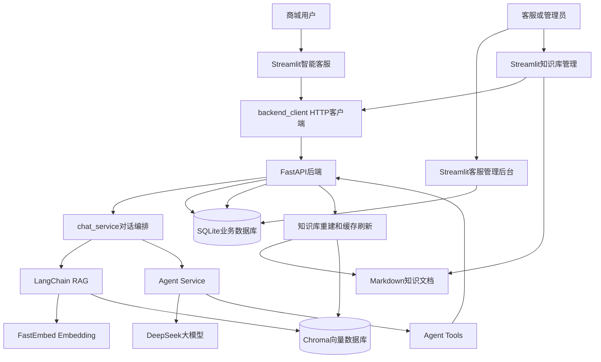
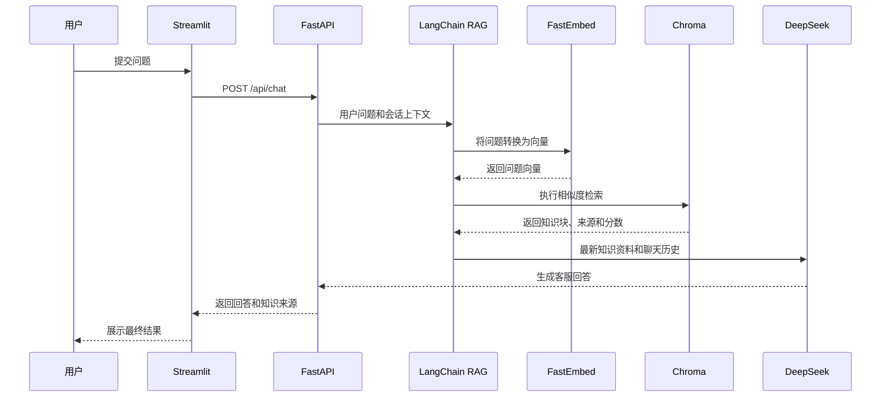
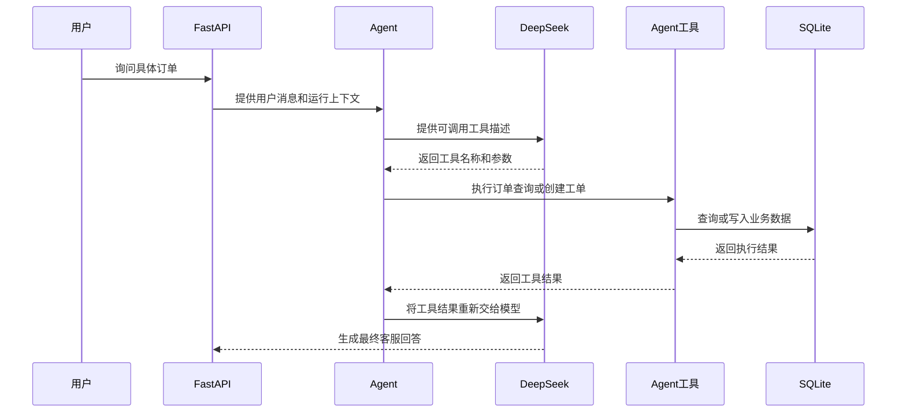
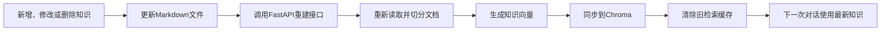

# 小丽商城企业知识库智能客服与工单 Agent 平台

一个面向电商客服场景的AI应用项目，集成企业知识库RAG、订单查询Tool Calling、人工工单流转、动态知识库管理和自动化评测。

项目使用Streamlit构建用户端和管理端页面，FastAPI提供后端接口，LangChain封装RAG检索流程，FastEmbed生成文本向量，Chroma保存知识向量，SQLite保存订单、会话、消息和工单数据。

## 一、项目背景

普通大模型无法直接获得商城的实时订单数据，也可能编造物流、退款、支付和发票政策。

本项目把用户问题分成两类：

- 商城规则问题：通过RAG从企业知识库检索资料；
- 订单和人工处理问题：通过Tool Calling查询订单或创建工单。

系统要求模型不得凭空编造订单、物流和商城政策。无法自动处理的问题，可以在用户明确确认后创建人工客服工单。

## 二、已实现功能

### 1. 智能客服

- 支持多轮客服对话；
- 支持普通咨询和关联订单咨询；
- 保存并加载历史咨询记录；
- 展示本次回答引用的知识来源；
- 支持“现在呢”“那可以吗”等上下文追问；
- 最新知识可以覆盖旧会话中的历史回答；
- 对知识库无法确认的问题进行拒答，避免编造规则。

### 2. 企业知识库RAG

- 读取Markdown企业知识文档；
- 按一级标题和二级章节进行知识切块；
- 使用FastEmbed生成文本向量；
- 使用Chroma持久化保存向量；
- 使用LangChain封装知识检索流程；
- 使用相似度阈值过滤无关知识；
- 返回来源文件、章节和相似度；
- 支持新增、修改和删除知识文档；
- 知识变化后自动重建Chroma；
- 自动清除FastAPI中的旧向量库缓存；
- 支持一键粘贴导入完整知识文档。

### 3. Agent与Tool Calling

- 由大模型判断当前问题是否需要调用工具；
- `query_order`：查询订单商品、金额、状态和物流；
- `create_support_ticket`：创建人工客服工单；
- 创建工单前必须获得用户明确确认；
- 防止同一次咨询重复创建工单；
- 工具执行结果会重新交给模型生成最终回答；
- 工具调用失败时向用户如实说明。

### 4. 工单管理

- 保存问题类型、标题、描述和优先级；
- 工单与客服咨询关联；
- 查看待处理和已处理工单；
- 修改工单状态；
- 防止同一次咨询重复创建工单。

### 5. FastAPI后端

- 提供订单、聊天、工单、会话和知识库接口；
- 使用Pydantic校验请求参数；
- 处理404、409、422和500等异常状态；
- Streamlit通过HTTP客户端调用FastAPI；
- 提供Swagger接口调试页面。

### 6. 自动化评测

- RAG检索准确性评测；
- 手写RAG与LangChain版本对比；
- Agent工具调用评测；
- FastAPI接口评测；
- 动态知识库新增、修改和删除评测；
- 自动清理评测过程中创建的临时知识。

## 三、系统架构



当前项目是本地MVP版本。智能客服主要通过FastAPI访问后端，客服管理后台仍有部分功能直接访问SQLite，后续计划继续迁移到FastAPI服务层。

## 四、RAG处理流程



RAG的主要流程是：

```text
用户问题
→ 上下文问题补全
→ 生成问题向量
→ Chroma相似度检索
→ 阈值过滤
→ 整理知识上下文
→ 交给大模型生成回答
```

## 五、Tool Calling处理流程



## 六、动态知识库更新流程



## 七、技术栈

| 分类 | 技术 |
|---|---|
| 开发语言 | Python 3.10+ |
| 用户端和管理端 | Streamlit |
| 后端接口 | FastAPI、Pydantic、Uvicorn |
| 大模型 | DeepSeek Chat |
| RAG框架 | LangChain |
| Embedding | FastEmbed、BAAI/bge-small-zh-v1.5 |
| 向量数据库 | Chroma |
| 业务数据库 | SQLite |
| HTTP客户端 | HTTPX |
| 自动化评测 | FastAPI TestClient、自定义评测脚本 |

## 八、项目结构

```text
Work_System/
├── AIassistant.py
│   └── Streamlit智能客服页面
│
├── api.py
│   └── FastAPI后端接口
│
├── backend_client.py
│   └── Streamlit与FastAPI之间的HTTP客户端
│
├── chat_service.py
│   └── 会话、RAG和Agent流程编排
│
├── agent_service.py
│   └── Agent多轮工具调用
│
├── agent_tools.py
│   └── 订单查询和工单创建工具
│
├── database.py
│   └── SQLite数据访问
│
├── rag.py
│   └── 文档读取、切块、Embedding和Chroma同步
│
├── langchain_rag.py
│   └── LangChain RAG适配和检索
│
├── knowledge_service.py
│   └── 一键导入知识文档的解析逻辑
│
├── pages/
│   ├── 1_客服管理后台.py
│   └── 2_知识库管理.py
│
├── knowledge/
│   └── Markdown企业知识文档
│
├── rag_evaluation.py
│   └── RAG检索评测
│
├── agent_tools_evaluation.py
│   └── Agent工具调用评测
│
├── api_evaluation.py
│   └── FastAPI接口评测
│
├── knowledge_management_evaluation.py
│   └── 动态知识库评测
│
├── requirements.txt
├── .env.example
├── .gitignore
├── README.md
└── shop.db
```

`shop.db`、`chroma_db`和聊天记录属于本地运行数据，不提交到Git仓库。

## 九、本地运行

### 1. 创建虚拟环境

```powershell
python -m venv .venv
```

激活虚拟环境：

```powershell
.\.venv\Scripts\Activate.ps1
```

### 2. 安装依赖

```powershell
python -m pip install -r requirements.txt
```

### 3. 配置环境变量

PowerShell示例：

```powershell
$env:DEEPSEEK_API_KEY="你的DeepSeek API Key"
$env:BACKEND_API_URL="http://127.0.0.1:8000"
```

不要把真实API Key写入代码，也不要提交到Git仓库。

### 4. 启动FastAPI

```powershell
python -m uvicorn api:app --reload --port 8000
```

启动成功后，可以访问：

```text
http://127.0.0.1:8000/health
```

Swagger接口文档地址：

```text
http://127.0.0.1:8000/docs
```

### 5. 初始化知识库

第一次运行时，需要把`knowledge`目录中的Markdown文档转换成向量并写入Chroma。

另开一个PowerShell终端，执行：

```powershell
Invoke-RestMethod `
    -Method Post `
    -Uri http://127.0.0.1:8000/api/knowledge/rebuild
```

也可以打开：

```text
http://127.0.0.1:8000/docs
```

在Swagger中执行：

```text
POST /api/knowledge/rebuild
```

正常情况下会返回文档数量和知识块数量。

### 6. 启动Streamlit

另开一个终端，执行：

```powershell
python -m streamlit run AIassistant.py
```

启动成功后，根据终端显示的地址打开页面，通常是：

```text
http://localhost:8501
```

运行期间需要同时保持两个终端：

```text
终端1：FastAPI后端
终端2：Streamlit前端
```

## 十、主要接口

| 方法 | 路径 | 作用 |
|---|---|---|
| GET | `/health` | 后端健康检查 |
| POST | `/api/chat` | 智能客服聊天 |
| GET | `/api/orders` | 查询订单列表 |
| GET | `/api/orders/{order_id}` | 查询单个订单 |
| POST | `/api/tickets` | 创建人工客服工单 |
| GET | `/api/conversations` | 查询咨询列表 |
| GET | `/api/conversations/{conversation_id}` | 查询咨询详情 |
| DELETE | `/api/conversations/{conversation_id}` | 删除咨询 |
| POST | `/api/knowledge/rebuild` | 重建知识库并清除缓存 |

## 十一、运行自动化评测

### 1. RAG检索评测

```powershell
python rag_evaluation.py
```

当前自建测试集结果：

```text
手写RAG：12/12通过
LangChain RAG：12/12通过
两个版本检索章节一致：12/12
```

### 2. Agent工具评测

运行前需要启动FastAPI：

```powershell
python agent_tools_evaluation.py
```

当前自建测试集结果：

```text
7/7通过
```

### 3. FastAPI接口评测

```powershell
python api_evaluation.py
```

当前自建测试集结果：

```text
10/10通过
```

### 4. 动态知识库评测

运行前需要启动FastAPI：

```powershell
python knowledge_management_evaluation.py
```

当前自建测试集结果：

```text
6/6通过
```

以上结果仅表示项目自建测试集的通过情况，不代表生产环境中的通用准确率。

## 十二、项目亮点

- 先手写实现文档读取、切块、向量生成、相似度过滤和上下文整理，再使用LangChain封装，并对两个版本进行对照评测；
- 使用Tool Calling连接大模型与订单、工单等业务数据，避免模型编造订单状态；
- 实现用户确认、参数校验和重复工单拦截等业务安全规则；
- 实现知识文档新增、修改、删除后的Chroma同步和FastAPI缓存刷新；
- 支持一键粘贴导入Markdown知识文档；
- 针对旧会话实现上下文追问补全和最新知识覆盖历史回答；
- 为RAG、Agent工具、FastAPI接口和动态知识库分别建立自动化评测。

## 十三、当前限制

- 当前使用SQLite和本地Chroma，主要适用于单机学习和项目演示；
- 暂未实现登录、角色权限和接口鉴权；
- 客服管理后台仍有部分功能直接访问SQLite；
- 知识文件目前保存在本地目录；
- 暂未加入Docker、线上部署、集中日志和监控；
- 当前测试集规模较小，还需要增加边界问题和失败案例。

## 十四、后续计划

- 增加管理员、客服和普通用户角色；
- 增加登录、权限校验和接口鉴权；
- 将管理后台的数据操作全部迁移到FastAPI；
- 抽取订单、工单和知识库Service层；
- 增加请求日志、工具调用日志和RAG检索监控；
- 增加响应耗时、召回率和拒答率指标；
- 使用Docker封装运行环境；
- 部署在线演示版本；
- 扩充RAG和Agent自动化评测集。